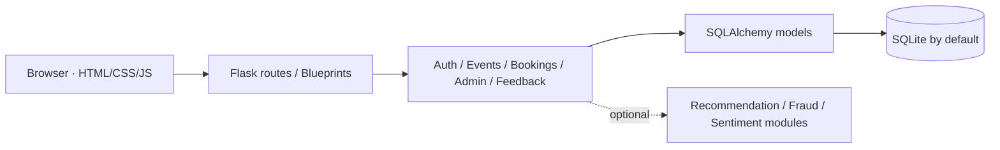

# ASSA Event Management Platform

**Python/Flask web application · Internship project**  
**Stack:** Python · Flask · SQLAlchemy · SQLite (default) · HTML/CSS · JavaScript

A web application designed to simplify event discovery, attendee registration, bookings and organizer administration. Shravya describes working on event-management functionality during her **Python & AI internship at Contriver (February–May 2026)**.

> This repository contains a **public portfolio code sample**. It is not advertised as a production deployment or a completed payment-processing system.

## Project at a glance

| Area | Description |
| --- | --- |
| Problem | Manual event registration and disconnected organizer workflows |
| Approach | Flask application with server-rendered pages, API routes and persistence |
| Users | Attendees, organizers and administrators |
| Core modules | Account registration/login, event discovery and management, bookings, tickets, feedback and dashboard views |
| Data access | Flask-SQLAlchemy models; SQLite configured by default |
| Additional code | Optional event recommendation, fraud scoring and sentiment-analysis modules |

## What Shravya worked on

Based on Shravya's supplied internship interview notes, her primary work included:

- **Authentication** — registration, login, session management and input validation.
- **Event management** — event listings, detail pages and administrative create/manage workflows.
- **Bookings** — booking creation, duplicate-booking checks and seat-management concepts.
- **Data layer** — CRUD operations and debugging database interactions.
- **Quality and testing** — tracing validation, navigation and booking-related problems.

These are **self-reported responsibilities** from the accompanying interview preparation document, not an independently audited contribution log.

## Architecture



## Source-code details

- The checked-in project uses **Flask Blueprints** and **Flask-SQLAlchemy**. Some interview notes describe direct `sqlite3` queries; the published code should be considered authoritative for its current architecture.
- `app/routes/bookings.py` implements duplicate-booking checks and booking status handling. **Atomic capacity updates/robust concurrent overbooking prevention are not established by this code**; do not describe them as proven.
- Ticket and payment-related flows are a **demonstration**, not a verified live payment integration.
- The recommender includes optional, data-dependent logic; trained model quality and deployment are not independently benchmarked.
- `schema.sql` is a **PostgreSQL-oriented reference schema**, while the Flask application defaults to SQLite. The database schema and migrations should be reviewed before deployment.

## Getting started (local development)

```bash
python -m venv .venv
# macOS/Linux
source .venv/bin/activate
pip install -r requirements.txt
cp .env.example .env
python app.py
```

On Windows activate with `.venv\Scripts\activate` and copy the environment example manually.

Then visit `http://127.0.0.1:5000`. Set `LOAD_ML_MODELS=0` for a lightweight preview. The complete installation and runtime behavior have **not been independently integration-tested** in this publication.

## Security and limitations

This repository is **for code review and portfolio purposes**. Do not deploy it publicly without a security review covering user-role assignment, input validation, authorization, booking races, secrets and payment-flow assumptions. Do not commit real customer information, service credentials or local databases.

## Learn more

See **[Project walkthrough and internship contributions](docs/PROJECT_WALKTHROUGH.md)** for a recruiter-friendly summary, the reported implementation challenges, and an explicit distinction between documentation and available code.
